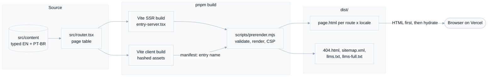

# Architecture

This page explains how gmartins.dev turns typed content into static HTML, and
what runs in the browser afterwards. Read it before you change routing, the
build, or anything in `<head>`. The reasons behind each choice are in the
[architecture decision records](adr/README.md).

## Build pipeline

The site has no runtime server. `pnpm build` produces everything Vercel
serves:

1. `pnpm typecheck` runs first; a type error stops the build.
2. Vite builds the client bundle (content-hashed files in `dist/assets/` and a
   manifest) and then the SSR bundle (`dist-ssr/`, never deployed).
3. `scripts/prerender.mjs` loads the SSR bundle, which validates all content
   against its schemas, then renders every path in `prerenderPaths` to
   `dist/<path>.html`.
4. Each page goes through `finalizeHtml()`: NUL characters in the router
   state become `\u0000`, and a Content-Security-Policy `<meta>` with the hash
   of every inline script goes first in `<head>`.
5. The script also writes `404.html` (bilingual, without client JavaScript),
   `sitemap.xml`, `llms.txt` (a short map for AI assistants) and
   `llms-full.txt` (the full English text of the case studies and products),
   all from the same content.

## Rendering model

The root route in `src/router.tsx` renders the whole document: `<html>`,
`<head>` with `HeadContent`, and `<body>` with the shell and `Scripts`. Every
page is a child route, registered once per locale from the `pages` table.

| Concern | Where it lives |
| --- | --- |
| Routes and the document shell | `src/router.tsx` |
| Page components | `src/pages/` |
| Shared UI (header, footer, work teasers, button styles) | `src/components/` |
| Content and copy, both languages | `src/content/` |
| Head tags, JSON-LD, sitemap | `src/seo.ts` |
| Locales and localized paths (`/` and `/pt-br`) | `src/i18n.ts`, `src/use-locale.ts` |
| Theme preference and the pre-paint script | `src/theme.tsx` |
| Server render and hydration | `src/entry-server.tsx`, `src/entry-client.tsx` |
| CSP, NUL escaping, script stripping | `src/csp.ts`, `src/finalize-html.ts` |

The dev server (`pnpm dev`) renders HTML through the same `entry-server.tsx`
with a small middleware in `vite.config.ts`, so dev and production markup
match.

## In the browser

1. The inline theme script in `<head>` applies the stored theme (or the system
   one) before the first paint.
2. The page is readable at this point; the client entry loads with low fetch
   priority so it doesn't compete with the largest image.
3. `RouterClient` hydrates `document` from the dehydrated router state.
4. After the `load` event, production builds add the Vercel Speed Insights
   script from `/_vercel/speed-insights/` for real-user Core Web Vitals
   ([ADR-006](adr/006-real-user-web-vitals-with-vercel-speed-insights.md)).
5. Later navigations happen on the client. TanStack Router resets the scroll
   position, `HeadContent` updates the head tags, and `RouteFocus` moves focus
   to the new page's `<h1>`.

## Hosting

Vercel serves `dist/` with clean URLs (`/about` serves `about.html`).
`vercel.json` adds the legacy short-link redirects, security headers, and cache
rules: immutable for hashed `/assets/`, one day with revalidation for
`/images/`. `scripts/serve-dist.mjs` mimics this behavior locally for the
end-to-end tests.

## Next steps

- [Maintenance guide](maintenance.md): how to change content, add pages, and
  keep the quality gates green.
- [Design guide](../DESIGN.md): tokens, typography, and UI rules.
- [Security](../SECURITY.md): the controls and how they are tested.
